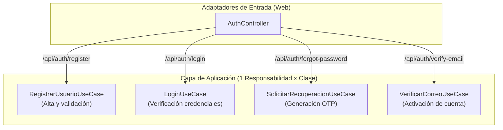
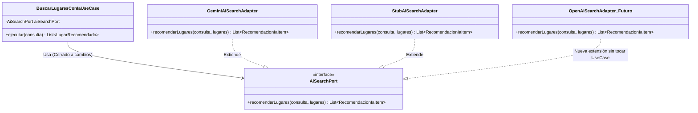
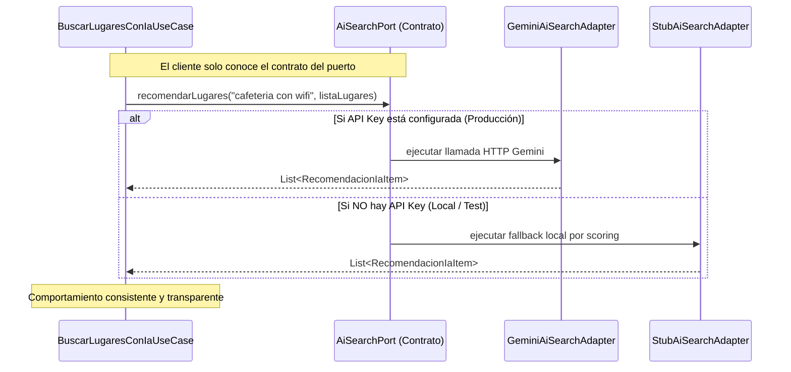
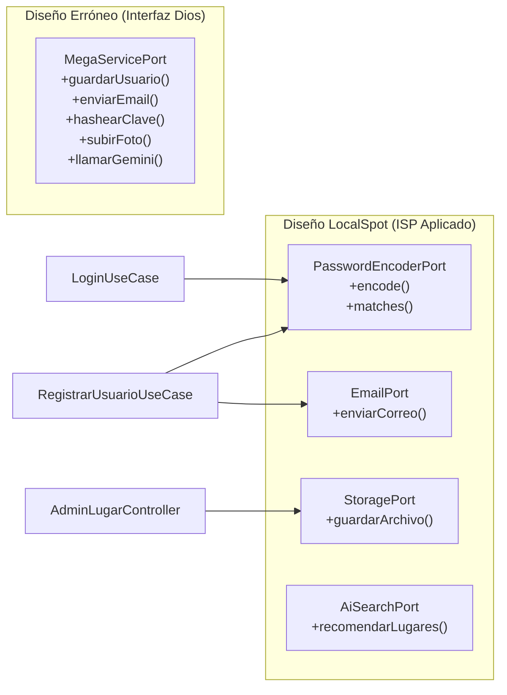

# Principios SOLID — Implementación y Evidencias Técnicas

**Proyecto:** LocalSpot Backend  
**Framework:** Spring Boot 3.3.5 / Java 17  
**Arquitectura:** Hexagonal (Ports & Adapters)  
**Fecha:** Noviembre 2026  

---

## Introducción

Los principios **SOLID** son un conjunto de cinco directrices de diseño de software orientado a objetos destinadas a crear sistemas mantenibles, desacoplados, escalables y testeables. En **LocalSpot Backend**, estos principios se articulan orgánicamente a través de la **Arquitectura Hexagonal**:

```
      S ── Single Responsibility Principle (SRP)
      O ── Open/Closed Principle (OCP)
      L ── Liskov Substitution Principle (LSP)
      I ── Interface Segregation Principle (ISP)
      D ── Dependency Inversion Principle (DIP)
```

A continuación se detalla cada principio con su explicación técnica, justificación en la arquitectura, fragmentos de código del proyecto y diagramas visuales (capturas arquitectónicas).

---

## 1. S — Single Responsibility Principle (SRP) — Principio de Responsabilidad Única

> *"Una clase o módulo debe tener una, y solo una, razón para cambiar."*

### Explicación en LocalSpot
En lugar de concentrar la lógica en controladores masivos o servicios Dios ("God Services"), cada caso de uso en la capa de aplicación implementa **una única operación de negocio bien definida**. 

Por ejemplo, las responsabilidades alrededor del usuario y la autenticación se encuentran estrictamente divididas:
- `RegistrarUsuarioUseCase`: Únicamente orquesta el alta de cuenta y envío de confirmación.
- `LoginUseCase`: Únicamente autentica credenciales y emite tokens JWT.
- `RestablecerContrasenaUseCase`: Únicamente gestiona el cambio seguro de credenciales con token temporal.
- `HttpLoggingFilter`: Su única responsabilidad es medir el tiempo de solicitud y registrar la telemetría en BD.

### Fragmento de Código: `RegistrarUsuarioUseCase.java`
Ruta: `src/main/java/com/example/demo/application/usecase/RegistrarUsuarioUseCase.java`

```java
public class RegistrarUsuarioUseCase {

    private final UsuarioRepositoryPort usuarioRepositoryPort;
    private final PasswordEncoderPort passwordEncoderPort;
    private final TokenVerificacionRepositoryPort tokenVerificacionRepositoryPort;
    private final EmailPort emailPort;
    private final long expiracionMinutos;
    private final String baseUrlVerificacion;

    // Solo se encarga de registrar: valida duplicados, hashea clave, persiste y despacha email
    public Usuario ejecutar(String nombre, String correo, String contrasenaPlana,
                            Usuario.TipoUsuario tipoUsuario) {
        if (usuarioRepositoryPort.existsByCorreo(correo)) {
            throw new CorreoDuplicadoException("El correo " + correo + " ya se encuentra registrado");
        }

        String hash = passwordEncoderPort.encode(contrasenaPlana);

        Usuario usuario = new Usuario();
        usuario.setNombre(nombre);
        usuario.setCorreo(correo);
        usuario.setContrasena(hash);
        usuario.setTipoUsuario(tipoUsuario != null ? tipoUsuario : Usuario.TipoUsuario.FINAL);
        usuario.setVerificado(false);

        Usuario guardado = usuarioRepositoryPort.save(usuario);
        generarYEnviarTokenVerificacion(guardado);
        return guardado;
    }
}
```

### Captura Conceptual / Diagrama SRP



---

## 2. O — Open/Closed Principle (OCP) — Principio de Abierto/Cerrado

> *"Las entidades de software deben estar abiertas para su extensión, pero cerradas para su modificación."*

### Explicación en LocalSpot
El sistema permite añadir nuevos mecanismos de integración (por ejemplo, un nuevo motor de IA o un nuevo proveedor de geocodificación) **sin modificar una sola línea de los casos de uso**.

El caso de uso `BuscarLugaresConIaUseCase` depende exclusivamente del contrato `AiSearchPort`. Si mañana se migra de Google Gemini a OpenAI o Claude, o si se desea usar un Mock/Stub en entornos sin conexión, no se toca el caso de uso: simplemente se implementa un nuevo adaptador que cumple con el puerto y se activa mediante `@ConditionalOnExpression`.

### Fragmento de Código: Adaptabilidad sin Modificación
Ruta: `src/main/java/com/example/demo/infrastructure/adapter/out/ai/`

```java
// Contrato cerrado a cambios en el Dominio
public interface AiSearchPort {
    record RecomendacionIaItem(Long idLugar, String motivo) {}
    List<RecomendacionIaItem> recomendarLugares(String consulta, List<Lugar> lugaresDisponibles);
}

// Extensión 1: Adaptador para producción (Google Gemini con API Key)
@Component
@ConditionalOnExpression("'${localspot.integrations.ai.api-key:}' != ''")
public class GeminiAiSearchAdapter implements AiSearchPort {
    @Override
    public List<RecomendacionIaItem> recomendarLugares(String consulta, List<Lugar> lugaresDisponibles) {
        // Llama a Google Gemini REST API con CircuitBreaker y Timeout
        ...
    }
}

// Extensión 2: Adaptador Fallback/Local (Sin modificar la aplicación)
@Component
@ConditionalOnExpression("'${localspot.integrations.ai.api-key:}' == ''")
public class StubAiSearchAdapter implements AiSearchPort {
    @Override
    public List<RecomendacionIaItem> recomendarLugares(String consulta, List<Lugar> lugaresDisponibles) {
        // Algoritmo determinístico local por scoring de palabras clave
        return fallbackBusqueda(consulta, lugaresDisponibles);
    }
}
```

### Captura Conceptual / Diagrama OCP



---

## 3. L — Liskov Substitution Principle (LSP) — Principio de Sustitución de Liskov

> *"Los objetos de un programa deben poder ser reemplazados por instancias de sus subtipos sin alterar la corrección del programa."*

### Explicación en LocalSpot
Cualquier implementación de un puerto puede sustituir a otra sin romper el comportamiento esperado ni lanzar excepciones no previstas por el contrato:
- En tests unitarios, `UsuarioRepositoryPort` es reemplazado por un doble de prueba o mock de Mockito.
- En entorno de integración se utiliza el adaptador JPA real (`UsuarioRepositoryAdapter`) conectado a PostgreSQL.
- En el subsistema de IA, tanto `GeminiAiSearchAdapter` como `StubAiSearchAdapter` respetan estrictamente la invariante de devolver una lista (vacía o poblada) de `RecomendacionIaItem`, sin que el llamador deba saber qué implementación está activa.

### Fragmento de Código: Sustituibilidad Verificada
Ruta: `src/main/java/com/example/demo/infrastructure/adapter/out/ai/StubAiSearchAdapter.java` y `GeminiAiSearchAdapter.java`

```java
// Caso de uso que consume la abstracción
public class BuscarLugaresConIaUseCase {
    private final AiSearchPort aiSearchPort;

    public List<LugarRecomendado> ejecutar(String consulta) {
        ...
        // Funciona IDÉNTICAMENTE con StubAiSearchAdapter o GeminiAiSearchAdapter
        List<AiSearchPort.RecomendacionIaItem> respuestaIa = 
                aiSearchPort.recomendarLugares(consulta, lugares);
        ...
        return resultado;
    }
}
```

Si el servicio externo de Gemini falla o no cuenta con API Key configurada, el componente `StubAiSearchAdapter` toma su lugar de forma totalmente transparente para el sistema, garantizando que el contrato se cumpla sin violar precondiciones ni postcondiciones.

### Captura Conceptual / Diagrama LSP



---

## 4. I — Interface Segregation Principle (ISP) — Principio de Segregación de Interfaces

> *"Los clientes no deben verse obligados a depender de interfaces que no utilizan."*

### Explicación en LocalSpot
En lugar de tener una única interfaz monolítica `Repository` o `ExternalServicePort` con decenas de métodos no relacionados, en LocalSpot **cada puerto de salida está granularmente segregado por función de negocio**:

- `AiRecommendationPort`: Únicamente expone `generateMotivo(...)`.
- `AiSearchPort`: Únicamente expone `recomendarLugares(...)`.
- `PasswordEncoderPort`: Únicamente expone `encode(...)` y `matches(...)`.
- `EmailPort`: Únicamente expone `enviarCorreo(...)`.
- `FavoritoRepositoryPort`, `CalificacionRepositoryPort`, `LugarRepositoryPort`: Cada uno gestiona únicamente su agregado de dominio.

### Fragmento de Código: Puertos Específicos y Compactos
Rutas: `src/main/java/com/example/demo/domain/port/`

```java
// 1. Interfaz especializada exclusivamente en encriptación de claves
public interface PasswordEncoderPort {
    String encode(String rawPassword);
    boolean matches(String rawPassword, String encodedPassword);
}

// 2. Interfaz especializada exclusivamente en notificaciones de correo
public interface EmailPort {
    void enviarCorreo(String destinatario, String asunto, String cuerpoHtml);
}

// 3. Interfaz especializada exclusivamente en sugerencias IA
public interface AiRecommendationPort {
    String generateMotivo(Lugar lugar, Preferencia preferencia);
}
```
Un caso de uso como `LoginUseCase` solo inyecta `PasswordEncoderPort` y `JwtServicePort`, manteniéndose 100% aislado de métodos de correo, almacenamiento o IA que no necesita.

### Captura Conceptual / Diagrama ISP



---

## 5. D — Dependency Inversion Principle (DIP) — Principio de Inversión de Dependencias

> *"Los módulos de alto nivel no deben depender de los módulos de bajo nivel; ambos deben depender de abstracciones. Las abstracciones no deben depender de los detalles; los detalles deben depender de las abstracciones."*

### Explicación en LocalSpot
Este es el pilar central de la arquitectura hexagonal de LocalSpot:
- **Módulo de Alto Nivel (Negocio):** `com.example.demo.application.usecase.*` y `com.example.demo.domain.*`.
- **Módulo de Bajo Nivel (Infraestructura / Frameworks):** Spring Data JPA, Hibernate, PostgreSQL, BCrypt, Google Cloud API.

Las clases de la capa de aplicación **NUNCA** importan clases de `infrastructure` (como `UsuarioJpaRepository` o `BCryptPasswordEncoder`). En su lugar, el caso de uso declara que necesita un `UsuarioRepositoryPort` o un `PasswordEncoderPort` (interfaces que residen en el **Dominio**). La infraestructura es quien implementa el puerto e invierte la flecha de dependencia.

### Fragmento de Código: Inversión en Configuración
Ruta: `src/main/java/com/example/demo/infrastructure/config/UseCaseConfig.java`

```java
@Configuration
public class UseCaseConfig {

    // El framework inyecta los adaptadores concretos (bajo nivel)
    // a los casos de uso (alto nivel) a través de sus puertos abstractos
    @Bean
    public RegistrarUsuarioUseCase registrarUsuarioUseCase(
            UsuarioRepositoryPort usuarioRepositoryPort,           // Puerto
            PasswordEncoderPort passwordEncoderPort,               // Puerto
            TokenVerificacionRepositoryPort tokenRepositoryPort,   // Puerto
            EmailPort emailPort,                                   // Puerto
            @Value("${localspot.verificacion.expiracion-minutos:1440}") long expiracionMinutos,
            @Value("${localspot.verificacion.base-url:http://localhost:3000/verificar}") String baseUrl) {
        
        return new RegistrarUsuarioUseCase(
                usuarioRepositoryPort,
                passwordEncoderPort,
                tokenRepositoryPort,
                emailPort,
                expiracionMinutos,
                baseUrl
        );
    }
}
```

### Regla Automatizada en ArchUnit
La inversión de dependencias no es solo una convención manual, sino una **regla de compilación forzada por tests** en [`HexagonalArchitectureTest.java`](file:///c:/Users/Danie/OneDrive/Documentos/LocalSpot_Backend/src/test/java/com/example/demo/HexagonalArchitectureTest.java):

```java
@ArchTest
static final ArchRule dominio_no_depende_de_infraestructura =
    noClasses()
        .that().resideInAPackage("..domain..")
        .should().dependOnClassesThat().resideInAPackage("..infrastructure..");

@ArchTest
static final ArchRule aplicacion_no_depende_de_infraestructura =
    noClasses()
        .that().resideInAPackage("..application..")
        .should().dependOnClassesThat().resideInAPackage("..infrastructure..");
```

### Captura Conceptual / Diagrama DIP

```mermaid
flowchart TD
    subgraph CapaAplicacion["Módulo de Alto Nivel (Aplicación)"]
        UseCase["RegistrarUsuarioUseCase"]
    end

    subgraph CapaDominio["Abstracción (Dominio)"]
        PortRepo["<<interface>>\nUsuarioRepositoryPort"]
        PortPass["<<interface>>\nPasswordEncoderPort"]
    end

    subgraph CapaInfraestructura["Módulo de Bajo Nivel (Detalles de Tecnología)"]
        AdapterRepo["UsuarioRepositoryAdapter\n(Spring Data JPA / PostgreSQL)"]
        AdapterPass["BCryptPasswordEncoderAdapter\n(Spring Security BCrypt)"]
    end

    UseCase -->|Depende de| PortRepo
    UseCase -->|Depende de| PortPass
    AdapterRepo ..|>|Implementa (Invierte)| PortRepo
    AdapterPass ..|>|Implementa (Invierte)| PortPass
```

---

## 6. Matriz Resumen de Cumplimiento SOLID

| Principio | Componente Representativo | Beneficio en LocalSpot |
| :--- | :--- | :--- |
| **S (Single Responsibility)** | `RegistrarUsuarioUseCase`, `LoginUseCase`, `HttpLoggingFilter` | Módulos pequeños, testeables de forma aislada y con un solo motivo de cambio. |
| **O (Open/Closed)** | `AiSearchPort` $\rightarrow$ `GeminiAiSearchAdapter` / `StubAiSearchAdapter` | Nuevos proveedores de IA o pasarelas se añaden sin alterar la lógica de negocio. |
| **L (Liskov Substitution)** | Reemplazo de adaptadores reales por Stubs o Mocks | La aplicación funciona idénticamente en pruebas unitarias y en producción Docker. |
| **I (Interface Segregation)** | `PasswordEncoderPort`, `EmailPort`, `StoragePort`, `AiSearchPort` | Los casos de uso solo conocen y usan los métodos estrictamente necesarios. |
| **D (Dependency Inversion)** | `UseCaseConfig` + Puertos de Dominio + Pruebas con `ArchUnit` | El núcleo de negocio no depende de Spring, Hibernate, PostgreSQL ni librerías de terceros. |
