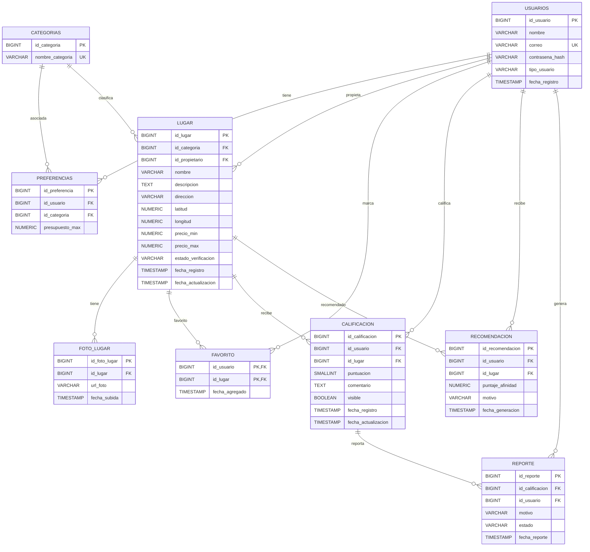

# Diagrama ERD - LocalSpot

## Notas

- **usuarios.tipo_usuario**: `ADMINISTRADOR`, `FINAL` o `PROPIETARIO`
- **lugar.estado_verificacion**: `PENDIENTE`, `VERIFICADO` o `RECHAZADO`
- **favorito** tiene PK compuesta `(id_usuario, id_lugar)`
- **calificacion** tiene restriccion UNIQUE `(id_usuario, id_lugar)`
- **preferencias** tiene restriccion UNIQUE `(id_usuario, id_categoria)`
